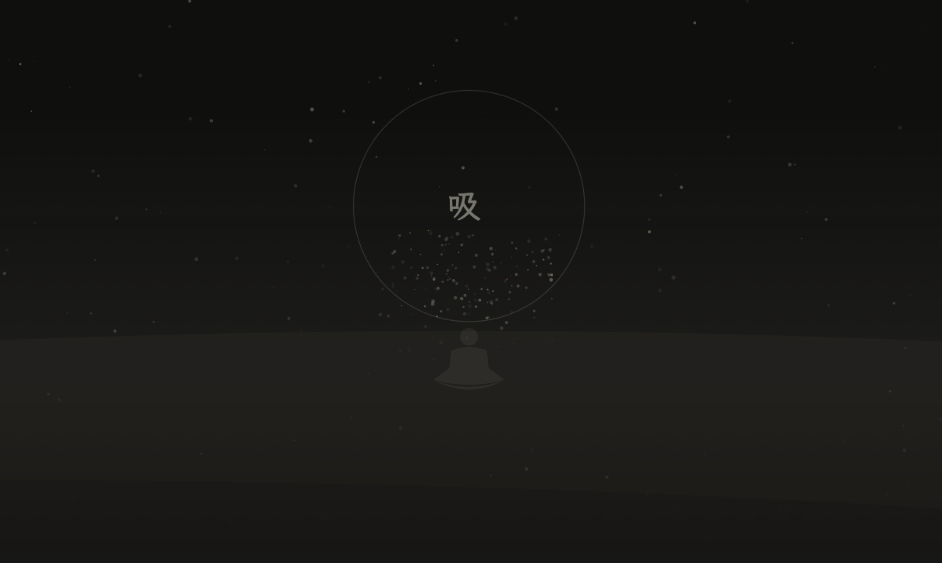

# 坐忘 Senza

> 受庄子「坐忘」启发的极简呼吸 H5。打开即静，雾散山谷，杂念随浮尘缓缓消散；零依赖、匿名统计与 7 日复访。

一个点在即入、随时抽离的网页静室。无账号、无广告、无打扰：轻触开始，跟随呼吸圆环（吸 4 秒 / 呼 6 秒），山谷与浮尘慢慢浮现，一句话浮现又缓缓融去，然后回到呼吸。

`Senza` 是意大利语的「without / 没有」，对应《大宗师》的「离形去知」——不是失忆，而是暂时放下身体、念头和身份。



## 快速开始

需要 Node.js 18+，**无需 `npm install`**（零依赖）。

```bash
npm start         # 生产启动
npm run dev       # 开发热更新（改 server.js 自动重启，需 Node 18.11+）
# 打开 http://127.0.0.1:3000
```

- 默认监听 `0.0.0.0`：本机、ECS 内网 IP、公网 IP 都能访问，无需改代码
- 端口被占用：`PORT=3001 npm start`
- 只想本机可访问：`HOST=127.0.0.1 npm start`
- 停止：按 `Ctrl+C`

部署到 ECS、systemd 托管、快速迭代与验证见 [DEPLOY.md](DEPLOY.md)。

## 体验与交互

| 元素 | 行为 |
| --- | --- |
| 呼吸圆环 | 吸 4 秒 / 呼 6 秒，约每分钟 6 次，参考共振呼吸区间 |
| 山谷 / 禅修者剪影 | CSS 分层山峦 + 内联 SVG，雾散后显现 |
| 浮尘 | Canvas 2D 程序化生成，默认缓缓下落、左右微幅飘移 |
| 核心词 | 自动出现，约 2.5 秒柔和消散后回到呼吸 |
| 右上「散去」图标 | 手动模式开关；开启后核心词下方才出现「长按」提示 |
| 右上声音图标 | 点击展开竖向音量滑杆，拖动调节、滑到底静音，选择会被记住；Web Audio 实时合成风声与颂钵，无音频素材、无网络请求 |
| 屏幕常亮 | 轻触开始后阻止自动息屏；优先用 Screen Wake Lock（需 HTTPS），HTTP 或微信 WebView 下降级为内联静音循环视频。切后台自动释放，回到前台恢复 |

默认自动播放；手动模式需长按屏幕让文字散去。字体、文案、配色分别集中在 `style.css` 和 `app.js` 顶部常量，改动方便。

## 目录结构

```
zuowang-mvp/
├── server.js                       # 零依赖 Node 服务：静态托管 / 埋点 / 统计
├── package.json
├── README.md
├── DEPLOY.md                       # ECS 部署与快速迭代方案
├── deploy/
│   ├── deploy.sh                   # 【主用】服务器一键部署：装 Node/建服务/生成密码/启动
│   ├── set-password.sh             # 交互式重设 ryadmin 后台密码
│   ├── setup-ecs.sh                # 兼容旧入口，实际调用 deploy.sh
│   ├── update.sh                   # 备用：服务器更新（保留埋点数据）
│   ├── dev-deploy.sh               # 备用：本机提交+推送+远程更新
│   └── zuowang.service             # systemd 服务模板
├── smoke-test.sh                   # 本地冒烟测试（会清空 data/visits.jsonl）
├── public/
│   ├── index.html                  # 页面结构
│   ├── style.css                   # 山谷、雾、呼吸圆环、配色与字体
│   ├── app.js                      # 状态机、浮尘、呼吸计时、声音与埋点
│   ├── ryadmin.html                # 后台登录与统计仪表盘
│   └── fonts/
│       ├── lxgw-wenkai-subset.woff2  # 霞鹜文楷子集，约 43KB
│       └── OFL.txt                   # SIL Open Font License 1.1
├── deploy/
│   └── set-password.sh             # 生成 ryadmin 密码哈希写入 .env
├── .env                            # 后台密码哈希与盐，已 gitignore（本地生成）
└── data/                           # 运行时生成，已 gitignore
    └── visits.jsonl                # 匿名事件流
```

## API

| 方法 | 路径 | 说明 |
| --- | --- | --- |
| `GET` | `/api/health` | 健康检查 |
| `POST` | `/api/pv` | 上报匿名事件 |
| `GET` | `/api/stats` | 实时统计（**需后台登录会话**） |
| `POST` | `/ryadmin/login` | 后台登录（user / pass） |
| `POST` | `/ryadmin/logout` | 退出登录 |
| `GET` | `/ryadmin/session` | 查询是否已登录 |
| `GET` | `/ryadmin` | 后台页面 |

后台用户名固定 `richard.yang`；密码由 `bash deploy/set-password.sh` 生成哈希存入 `.env`（scrypt + 随机盐，明文不落盘）。会话用 HttpOnly Cookie，重启失效；同 IP 连错 5 次锁 15 分钟。

`POST /api/pv` 请求体：

```json
{
  "id": "uuid-v4",
  "ts": 1731912345000,
  "event": "page_view",
  "src": "qr",
  "duration": 45000
}
```

`event` 取值：`page_view` / `fog_revealed` / `dissipate_done` / `exit`。`src` 最长 32 字符。

`GET /api/stats` 返回：

```json
{
  "pv": 4,
  "uv": 3,
  "avg_dwell_sec": 45.0,
  "calm_3s_rate": 100.0,
  "source": { "qr": 1, "direct": 1, "short": 1 },
  "funnel": { "entered": 3, "fog_revealed": 1, "dissipate_done": 1, "exited": 1 },
  "funnel_rate_pct": { "fog_revealed": 33.3, "dissipate_done": 33.3, "exited": 33.3 },
  "day7_return": { "mature": 2, "returned": 1, "rate": 50.0 },
  "daily": [{ "date": "2026-11-18", "pv": 4, "uv": 3 }],
  "recent": [{ "ts": 1731912345000, "id": "aaaaaaaa", "src": "qr", "event": "page_view" }]
}
```

## 统计口径

- **PV / UV**：按 `page_view` 事件计数 / 按匿名 id 去重。
- **漏斗与停留**：各阶段按 id 去重人数；平均停留取 `exit` 事件的 `duration`；`calm_3s_rate` 为停留 >3 秒的占比。
- **来源**：按每个 id 的首次 `page_view` 归属，缺失记为 `direct`。
- **7 日复访**：对每个匿名 id 取首次访问时间 `first`，**只统计已满 7 天的访客**（`first <= now - 7d`）；窗口为 `(first, first + 7d]`；在窗口内再次出现 `page_view` 即算复访。未复访者同样计入分母（LEFT JOIN 语义），避免高估。

## 隐私

浏览器用 `crypto.randomUUID()` 生成匿名 id 并存在 `localStorage`，只记录行为事件，**不采集任何身份信息**。数据仅写入项目内 `data/visits.jsonl`，已加入 `.gitignore`。

## 字体许可

核心文案使用**霞鹜文楷 LXGW WenKai** 子集（约 43KB），遵循 SIL Open Font License 1.1，可商用、可嵌入、可再分发子集；许可全文见 `public/fonts/OFL.txt`。字体本地加载，`font-display: swap`，不会阻塞首屏。

## 后台管理

浏览器打开 `http://127.0.0.1:3000/ryadmin`，用户名 `richard.yang`，密码首次用脚本设置：

```bash
bash deploy/set-password.sh     # 交互式输入密码，写入 .env（哈希+盐，权限 600）
npm start                       # 重启后生效
```

登录后可见：来过的人 / 总浏览 / 7 日复访 / 平均停留四张卡，每日访问趋势、来源占比、最近 20 条访问明细。

## 本地验证

启动服务后运行：

```bash
SMOKE_PASS=你的密码 ./smoke-test.sh
```

脚本会先登录拿会话 Cookie，再清空 `data/visits.jsonl` 注入 4 条样本，预期输出 `pv=4, uv=3, day7.mature=2, day7.returned=1, day7.rate=50`。脚本内含本机绝对路径，仅用于本地调试。
